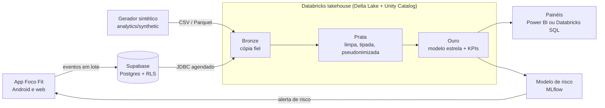

# Arquitetura de dados

## Camadas

| Camada | Onde | Conteúdo | Quem lê |
| --- | --- | --- | --- |
| Operacional | Supabase (Postgres) | `profiles`, `vinculos`, `registros_dia`, `eventos` | App, com RLS por usuário |
| Bronze | Databricks | Cópia fiel das tabelas + `_ingerido_em`, `_origem` | Só o pipeline |
| Prata | Databricks | Tipos corretos, deduplicado, `aluno_hash` no lugar do id | Analistas |
| Ouro | Databricks | Fatos diários e dimensões (estrela), tabela de KPIs, features de ML | Painéis, modelo |

## Decisões

1. **Eventos além do `registros_dia`.** O `registros_dia` guarda o estado final do dia; os eventos guardam o que aconteceu e quando. Sem a hora, não dá para estudar horário de registro, sequência ou efeito de notificação.
2. **Supabase continua sendo a fonte.** O lakehouse só lê. Nada de análise roda sobre o banco do app.
3. **Dados sintéticos com o mesmo formato.** O app tem poucos usuários; o gerador permite construir e validar o pipeline, a estatística e o ML agora, e trocar pela base real conforme ela cresce.
4. **Pseudonimização na prata.** O hash do aluno usa um sal guardado em secret scope, então o lakehouse não reidentifica ninguém sozinho.
5. **Databricks Free Edition.** Sem custo, com Unity Catalog, SQL Warehouse, Workflows e MLflow, que é o que as vagas pedem.
